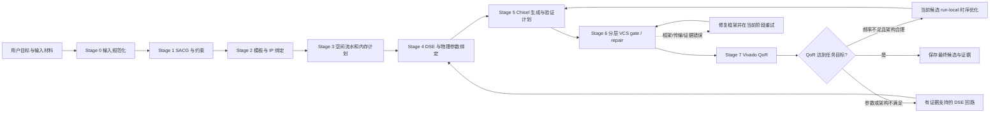

# SpatialAccAgent：面向 FPGA LLM 空间加速器的 Multi-Agent 自动设计框架
**文档用途**：论文写作、方法复现、实验结果边界说明与系统实现索引。

**证据截止时间**：2026-10-23 12:34（Asia/Shanghai）。

**本次实现与实验结果补充日期**：2026-10-23（Asia/Shanghai）。第 20 节依据当前 run 的验证报告、Vivado QoR、DSE 估算和逐轮时序历史更新；每个指标仍按其证据等级标注。

**仓库**：`/home/remote/workspace/Qwen2-Accelerator`。

**当前框架版本口径**：以本仓库 `accagent/framework/` 和当前 run 产物为准；早期 OPT/浮点产物仅作为历史参考，不代表当前 W4A8 run 的事实。

本文档不是某一个模型或某一组参数的操作日志，而是对 SpatialAccAgent 的设计目标、状态表示、Agent 组织、阶段流程、硬件模板、数值体系、验证闭环、DSE、后端证据和实验边界的系统化说明。涉及“已通过”“真实性能”“最佳设计”等表述时，必须同时检查对应 run 的 checkpoint、工具日志和 evidence receipt；本文档本身不替代真实工具证据。

## 1. 论文定位与核心问题

### 1.1 研究对象

SpatialAccAgent 是一个面向 decoder-only Transformer/LLM 的 FPGA 空间加速器自动设计系统。系统接收目标模型、量化策略、目标 FPGA/DDR/AXI 板级材料、工具链边界和性能/资源目标，自动完成从输入事实整理、模型语义抽取、硬件模板绑定、空间数据流规划、物理参数搜索、Chisel 代码展开、分层验证、故障修复到 Vivado 后端闭环的设计流程。

系统的研究对象是 **contract-preserving spatial accelerator design closure**：在多个 lowering boundary 之间保持同一组模型、形状、数值、数据流、存储、接口、时序和部署契约，而不是简单地让 LLM 输出一段看起来像 RTL 的文本。

### 1.2 论文主线

论文可以将方法概括为：

> SACG-guided, template-constrained, checker-verified design closure for FPGA LLM spatial accelerators.

其中：

- **SACG-guided**：以 Spatial Accelerator Contract Graph 作为跨阶段共享的结构化设计状态；
- **template-constrained**：计算、缓存、AXI/DDR 和板级壳由可信模板与物理 IP 约束，LLM 负责选择、绑定和解释，不负责无边界地产生硬件；
- **checker-verified**：每次阶段迁移都需要对应的静态检查、结构检查或真实工具证据；
- **design closure**：目标是形成可以继续进入验证、综合、实现和部署的完整 artifact package，而不是只完成代码生成。

### 1.3 具体问题

给定异构输入资料：

1. 目标模型配置和真实权重；
2. 模型算子语义、张量形状和序列长度；
3. 量化和数值精度约束；
4. FPGA 型号、板卡样例工程、DDR/AXI wrapper、时钟/复位和 runtime；
5. Chisel/RTL 算子模板和可用 FPGA IP；
6. 资源、频率、吞吐和功耗目标；
7. VCS、Vivado、远程服务器等工具边界；

系统需要自动产生一个结构化、可验证、可部署的空间加速器设计，并在工具失败、契约冲突和硬件 bug 出现时进行有证据约束的 repair loop。

### 1.4 非目标

SpatialAccAgent 不是以下系统：

- 任意 HDL chatbot 或自由格式 Verilog 生成器；
- 只把 PyTorch 图转换成 HLS 的编译器；
- 只做 DSE 预测而不生成硬件的搜索器；
- 只用 smoke test 或空顶层证明“硬件正确”的脚本集合；
- 只针对 OPT 固定常数的定制脚本。

目标是模型、板卡和量化策略可替换的领域专家式工作流。OPT 是早期成功案例和架构参考，当前框架必须通过输入材料和 LLM 适配新模型，而不是在核心代码中写死 OPT 的 hidden size、层数、地址或端口。

### 1.5 成功标准与 claim 边界

严格意义上的一次完整成功 run 应同时具备：

- 显式 SACG，且关键节点、边、约束和证据来源可追溯；
- 模型算子与空间 pipeline 的语义、形状和数据顺序一致；
- 真实权重、激活、量化参数和真实 AXI/DDR 运行时映射；
- 通过定义好的分层验证和 repair loop；
- 通过目标板卡 app-shell 的综合/实现约束；
- 输出真实资源、频率、功耗、周期和吞吐报告。

论文中必须限定性能比较的 envelope：模型家族和规模、序列长度、batch、W4A8 精度、目标 FPGA、DDR/AXI 假设、时钟、吞吐定义和 runtime 条件。不能把单一模型/板卡结果泛化成“所有 FPGA LLM 的绝对最优”。

## 2. 系统边界与状态模型

### 2.1 三类核心状态

框架把设计状态表示为：

```text
S_t = (G_t, A_t, R_t)
```

其中：

- `G_t`：当前 Spatial Accelerator Contract Graph（SACG）；
- `A_t`：当前 artifact set，包括结构化输入、模板绑定、生成源码、脚本、内存镜像、验证计划和后端文件；
- `R_t`：证据与运行记录，包括 checker、LLM 输出、工具日志、VCS/Vivado 报告、repair episode 和阶段 checkpoint。

每个阶段执行一个受约束的状态转换：

```text
(G_t, A_t, R_t) -> (G_{t+1}, A_{t+1}, R_{t+1})
```

状态转换必须产生可检查的变化。LLM 的自然语言意见不能单独改变设计状态；它必须被解析为符合 schema 的结构化结果，再由 deterministic tool、checker 或真实工具证据确认。

### 2.2 持久化原则

run 产物保存在 `accagent/runs/`，而不是 `/tmp`。每个 run 包含：

```text
accagent/runs/<run_id>/
  input/
  constraint_extraction/
  template_selection/
  pipeline_planning/
  parameter_binding/
  code_generation/
  verification_artifacts/
  debug_loop/
  backend_board/
  generated/
  verification/
  agent/
```

这些是当前执行器使用的主要报告目录；具体子目录按阶段和实际执行的工具动态创建，并非每个 run 都会拥有每一种工具产物。Stage 0 的输入准备产物写在 `input/`，SACG 状态由各阶段报告目录中的状态文件传递，运行级控制状态写在 `agent/`。

`/tmp` 只用于可重建的锁、SSH known-host、短暂传输 staging 等进程协调文件。LLM 记录、阶段报告、checkpoint、远端真实工具证据必须写入持久目录。运行可在中断后从仍然有效的 checkpoint 恢复；失效、过期或 hash 不匹配的 artifact 不得晋升为成功证据。

### 2.3 框架与真实工具的边界

框架负责：

- 解析和规范化用户输入；
- 调度 stage agent、team agent 和 deterministic tool；
- 构造/更新 SACG；
- 调用真实 VCS/Vivado/远程工具；
- 收集日志、分类失败、生成 repair action；
- 管理 artifact、证据和恢复。

真实工具负责：

- Chisel/SBT 编译与 elaboration；
- VCS 编译、elaboration、link 和可选仿真；
- Vivado synthesis、implementation、timing、power 和资源报告；
- 目标板卡 runtime 或板级模拟。

LLM 负责理解异构材料、提出结构化设计决策、分析当前证据和生成受边界约束的下一步动作。LLM 不是 QoR 权威，也不能覆盖 checker、真实工具失败或当前 SACG 的硬约束。

## 3. SACG：Spatial Accelerator Contract Graph

### 3.1 形式化定义

SACG 表示为：

```text
G = (V, E, C, I, A)
```

- `V`：节点集合，表示模型、模板、处理单元、pipeline stage、接口、存储、验证和部署对象；
- `E`：有向边集合，表示数据、控制、形状、数值、内存和生命周期关系；
- `C`：约束集合，表示必须保持的 contract；
- `I`：不变量集合，表示跨阶段必须持续成立的 invariant；
- `A`：artifact/evidence association，绑定来源文件、路径、hash、工具日志和阶段证书。

SACG 不是静态的 model graph，也不是只描述模块连线的 RTL graph。它把高层模型事实、中层空间数据流和低层实现/部署边界放在同一可追踪对象中。

### 3.2 节点类型

常见节点包括：

| 节点类别 | 典型内容 | 主要检查 |
|---|---|---|
| model | decoder block、layer、operator | 模型拓扑、层数、算子顺序 |
| shape | hidden size、head 数、head dim、序列长度、tile shape | 维度一致性、广播和尾 tile |
| numeric | W4A8、INT32 accumulator、scale/shift | 位宽、符号、舍入、饱和 |
| template | Linear、QKV、attention、FFN、norm、softmax | 模板 provenance 和端口语义 |
| processing unit | PE、lane、MAC、reduction tree | 阵列尺寸、并行度、DSP 映射 |
| pipeline stage | operator stage、token stream stage | stage 顺序、启动/完成和 backpressure |
| stream adapter | ready/valid、FIFO、width converter | beat、握手、回压和数据顺序 |
| memory/runtime | DDR、active/shadow cache、activation ping-pong | 地址、stride、liveness、prefetch |
| verification | leaf、single-layer、board-level | 验证输入、wrapper、gate 和 repair |
| backend/deployment | Vivado、XDC、app-shell、XDMA | 资源、Fmax、时序、板卡接口 |

### 3.3 边类型

SACG 中的边至少覆盖：

- **semantic edge**：模型算子语义到硬件算子语义；
- **shape edge**：输入/输出维度、head mapping、tile 和 residual 对齐；
- **numeric edge**：权重、激活、累加、scale、shift 和输出量化之间的关系；
- **stream edge**：ready/valid、token 流、阶段间回压；
- **beat edge**：AXI beat、cache word、pack/unpack 和 burst；
- **memory edge**：DDR region、layer stride、tile stride、cache bank；
- **control edge**：启动、完成、状态、calibration 和 reset；
- **residual/KV edge**：残差、QKV、attention context 和跨层状态；
- **liveness edge**：数据何时写入、何时可读、何时可释放或切换；
- **runtime edge**：host 地址、控制寄存器、输出读取和 XDMA；
- **backend edge**：模板/IP 到 Vivado 工具、XDC、implementation report；
- **deployment edge**：生成顶层到真实 app-shell 和板级运行命令。

### 3.4 Contract 与 invariant

典型 contract 包括：

```text
model.decoder
shape.model
numeric.policy
template.library
stream.order
stream.ready_valid
memory.board
memory.layout
runtime.board
verification.plan
backend.package
backend.app_shell_integration
deployment.board
```

典型 invariant 包括：

1. 目标模型的 Transformer block 拓扑不因优化被删除或串化；
2. 完整权重保存在 DDR，片上只保留有界 active/shadow cache；
3. 512-bit AXI/DDR beat、cache refill 和地址粒度保持一致；
4. W4A8 数据通路不在 elaborated hierarchy 中实例化浮点 IP；
5. token 在各算子 stage 之间允许时间重叠，ready/valid 正确回压；
6. layer/tile 的固定 stride 不因 tail tile 缩短而改变；
7. board wrapper 使用用户提供的真实 AXI/DDR 信号和时钟复位；
8. 证据必须绑定到当前源码、当前参数和当前工具环境；
9. 只有真实工具报告能产生实现级 QoR claim；
10. 低层通过的证书不能阻止后续层在出现直接矛盾证据时重新审查。

### 3.5 CCTG 与 SACG 的关系

SACG 描述设计的静态和动态契约。CCTG（Causal/Contract Causal Trace Graph）用于把工具失败、内部观测和约束边界组织成可修复的因果切片。典型 repair 过程是：

```text
real tool evidence
 -> failure classifier
 -> violated contract / CCTG frontier
 -> candidate repair boundary
 -> LLM repair action
 -> atomic source transaction
 -> same-layer real tool recheck
```

CCTG 不是让 LLM 凭经验猜 bug 的替代品；它把当前失败对应的信号、边界、前置条件和可编辑文件范围显式化，使 repair 不会任意扩散到共享模板、输入事实或已证明无关的模块。

## 4. Agent 组织与职责

### 4.1 顶层控制器

`accagent/framework/agent.py` 的 `TopAgent` 是 run-level controller。它负责读取配置、初始化 run、恢复 checkpoint、依次调用 Stage 0–7、写入 report、保存状态和决定下一步迁移。它不直接替代 stage agent 修改硬件；它协调 LLM、deterministic tool、SACG store、checker、remote tool 和 artifact persistence。

### 4.2 Stage agent

每个主要阶段有一个 stage-local LLM worker：

| 阶段活动 | 主要 agent |
|---|---|
| constraint extraction | `sacg_builder_agent` |
| template selection | `template_selection_agent` |
| pipeline planning | `pipeline_architect_agent` |
| parameter binding | `dse_parameter_agent` |
| code generation | `code_generation_agent` |
| verification artifacts | `verification_planner_agent` |
| verification | `evidence_classifier_agent` |
| repair | `repair_agent` |
| backend | `backend_closure_agent` |

stage agent 的输出必须是 schema 约束的 JSON，包含 summary、evidence citations、violated/updated constraints、next action 和 acceptance checkers 等字段。自然语言解释可以作为附加信息，但不能替代结构化字段。

### 4.3 Team layer

每个 stage 还可以由 `team_decomposer` 将任务拆成少量芯片设计团队角色。典型角色族：

- `model_shape`：模型图、shape、head mapping、算子顺序和 residual；
- `numeric_template`：量化、模板、参数、资源风险和 IP 绑定；
- `data_memory_runtime`：数据顺序、stream、beat、DDR、runtime 和 liveness；
- `verification_repair`：验证边界、失败分类、repair gate 和 evidence；
- `implementation_deployment`：综合、时序、板级壳、部署和 QoR。

team decomposer 输出：

```text
role_profile
action_type
expected_artifacts
acceptance_checkers
handoff_to
handoff_rule
parallel_group
```

同一 `parallel_group` 内的独立专家可并发，后续审计组在前组产物存在后再运行。团队事件写入：

```text
<stage>/team/decomposer_prompt.md
<stage>/team/decomposer_result.json
<stage>/team/subtask_plan.json
<stage>/team/team_aggregate.json
<stage>/team/event_log.jsonl
```

团队角色不能绕过 checker、修改 golden output、放宽 tolerance、自由改写任意 RTL 或凭 LLM 输出声称硬件通过。

### 4.4 共享经验库

Stage 6 的每次验证/repair intervention 都会形成一个 compact episode，写入：

```text
accagent/runs/_shared_experience/repair_experience.jsonl
```

episode 包含当前失败证据、SACG/CCTG 上下文、原子文件变更、请求的验证命令、验证结果、evidence grade 和 outcome。可检索 outcome 只有：

- `validated_success`；
- `falsified`。

`inconclusive` 只保留为历史记录，不作为正向经验。经验检索按 failure class、violated contract、CCTG frontier、stage role、verification scope 和 repair gate 匹配，只提供少量先验，不能扩大当前可编辑文件范围，也不能替代当前层的真实工具复核。

## 5. LLM 接入与消息协议

### 5.1 配置解析

`llm_config.py` 统一解析：

- `SPATIALACC_LLM_*` 环境变量；
- `~/.codex/config.toml` 的 `model_provider`、`model`、`base_url`、`wire_api` 和 reasoning effort；
- `~/.codex/auth.json` 或 provider `env_key` 中的密钥。

框架只把密钥用于进程内请求，不把密钥写入 run 文档、上下文记录或论文数据。请求记录应保留 provider、model、endpoint、prompt hash、耗时、重试次数和返回状态，但不保留 secret。

### 5.2 统一请求路径

当前工作流通过 `llm_io.py`、`stage_llm.py` 和 `stage_team.py` 发送结构化 prompt。每个请求包含：

1. 系统角色和论文问题边界；
2. 当前 stage 的任务和输出 schema；
3. 当前 SACG truth、开放约束和已知证据；
4. 当前材料摘要和文件路径；
5. 禁止事项和 human-boundary；
6. 需要确认的 acceptance checkers。

响应必须经过 JSON 提取、schema validation、字段完整性检查和 evidence grounding。JSON 解析失败、transient HTTP 错误或 provider capacity 错误按配置 retry；正式 LLM mode 下无法得到合法响应时 stage 不应伪造成功。

### 5.3 不确定性与重试

网络 502/503、临时过载和 transport 错误属于上游不稳定，不应被误判为硬件失败，也不应导致流程回退到 Stage 0。框架在相同 stage 内保持重试；只有当前设计证据显示目标不满足，才进入优化循环或允许按明确边界回到更早阶段。

### 5.4 LLM 的权限边界

LLM 可以：

- 解释材料并输出结构化约束；
- 选择可信模板和候选参数；
- 生成 pipeline/memory/runtime 规划；
- 分析当前工具输出并提出局部 repair；
- 选择测量优先级和后端下一步动作。

LLM 不可以：

- 用预测 QoR 替代 Vivado/硬件计数器；
- 用旧 run 的 hash 或报告覆盖当前证据；
- 修改真实模型事实、golden output 或 tolerance 以制造 pass；
- 绕过真实 AXI/DDR wrapper；
- 把 compile-only pass 写成 functional simulation 或上板 pass；
- 在没有当前 trace contradiction 时任意重开已认证低层。

## 6. Stage 0：目标与输入准备

### 6.1 输入

Stage 0 接收：

- 用户自然语言目标；
- 本地/HuggingFace 模型配置和权重路径；
- 目标序列长度、batch 和模型范围；
- 量化文档；
- FPGA/DDR/AXI 板卡材料和样例工程；
- Chisel/RTL 模板元数据；
- 工具链资料和远端执行方式；
- 资源、时钟、吞吐和功耗目标。

当前材料目录为：

```text
accagent/framework/input_materials/board/
accagent/framework/input_materials/quantization/
accagent/framework/input_materials/tools/
```

### 6.2 子 agent

Stage 0 由以下角色把非结构化材料变成结构化输入：

```text
model_config_agent
task_card_agent
numeric_policy_agent
board_profile_agent
design_space_agent
```

每个角色必须保留字段来源和 excerpt。来源优先级高于 LLM 推断；无法由材料确认的关键字段应标记 unknown/pending，而不是填入模型常数。

### 6.3 输出

Stage 0 的典型输出：

```text
input/model_config.json
input/task_card.json
input/numeric_policy.json
input/target_board_profile.json
input/design_space.json
input/prepared_inputs.json
input/field_evidence.json
```

`prepared_inputs.json` 只有在模型、量化、板级接口、工具边界和设计空间均完成基本一致性检查后才可为 `ready`。

### 6.4 检查和失败行为

检查包括：

- 模型家族、层数、hidden/head/FFN 等基本 shape；
- 目标模型权重 header 与声明的后缀是否匹配；
- W4A8 或其他数值策略是否有明确 signedness、scale、rounding 和 saturation；
- AXI width、address、clock、reset、calibration 和 runtime 地址是否有来源；
- 设计空间是否仅包含物理绑定的参数；
- 工具命令和远端服务器是否可执行。

缺失 case adapter、矛盾 shape 或缺失板级事实时，Stage 0 在当前层重试或产生明确 blocker；不能通过复制另一个模型的 adapter、使用空 wrapper 或默认固定地址绕过。

## 7. Stage 1：SACG 抽取

### 7.1 目标

把 Stage 0 的结构化输入转换为初始 SACG，并把事实、推断、约束和证据来源分开。Stage 1 不是生成 RTL，而是建立后续所有决策必须共享的“设计合同”。

### 7.2 主要动作

1. 从模型 config/adapter 提取 decoder block、层数、算子顺序、attention head/KV head 和 FFN；
2. 建立 shape nodes 和 shape edges；
3. 建立 W4A8 numeric nodes、量化 scale/shift、累加和输出格式；
4. 建立 board/memory/runtime nodes；
5. 把模板候选、验证范围和后端边界写入 SACG；
6. 建立 facts/invariants 的来源引用和 confidence；
7. 运行 shape、numeric、scope、source-consistency checkers。

### 7.3 迁移条件

Stage 1 通过要求：

- SACG schema 合法；
- 所有 critical field 有权威来源或明确 pending；
- model graph 与 adapter/权重事实一致；
- 未发现无法解释的 shape/numeric/board contradiction；
- Transformer block 范围和非目标算子范围明确。

## 8. Stage 2：可信模板与 FPGA IP 绑定

### 8.1 可信模板思想

LLM 不直接从零生成任意硬件。框架维护 `templates/operator_chisel/` 以及生成所需的 top、memory、stream、board glue 模板。LLM 选择模板、填入模型派生参数、提出局部 glue 变化，并由 template provenance、端口和 contract checker 验证。

### 8.2 模板覆盖

模板库应覆盖 Transformer block 中的：

- Linear/MatMul；
- Q/K/V projection；
- attention score QK；
- Softmax 或其固定点近似；
- probability/context PV；
- output projection；
- RMSNorm/LayerNorm；
- FFN 的 up/down/gated projection；
- residual/add/quantize；
- stream FIFO、width conversion、tile loader；
- active/shadow cache；
- AXI/DDR board adapter；
- cycle counter、status/control 和 runtime wrapper。

### 8.3 W4A8 绑定

当前 run 的数值策略 supersede 早期浮点策略：

```text
weight       = signed INT4
activation   = signed INT8
accumulator  = signed INT32
bias         = signed INT32 或显式更宽整数
scale        = INT32 fixed-point/Q31 体系
rounding     = nearest-even
output       = saturating INT8
backend      = integer DSP/fixed-point
```

整数 branch 的 elaborated hierarchy 不得实例化浮点 IP。浮点源码可以保留给其他数值 policy，但当前 W4A8 生成包必须只展开 integer/DSP 路径。

### 8.4 IP 与 VCS 闭包

模板绑定不仅是 Scala 类型检查，还必须定义仿真闭包：

- XPM memory 模型；
- Vivado/FPGA IP 仿真模型（若某 policy 使用 IP）；
- `unisims_ver`/`glbl.v` 等必要库；
- 同一模块接口、延迟和时序语义；
- VCS compile/elaboration/link 的 include、define、library 和 top。

不可用 simulation-only `Mem`、空 memory、随意 `Queue` 或另一个宽度的简化 wrapper 替代目标板级实现。

### 8.5 检查

Stage 2 重点检查：

- template provenance hash；
- operator 端口和 shape；
- numeric policy 到模板 backend 的绑定；
- XPM BRAM/URAM 与参数的物理关系；
- board adapter 端口、AXI beat 和 clock/reset；
- 模型 head mapping 和 attention projection 语义。

Gemma 等具有 MQA、Q/K norm、RoPE 或特殊 gated MLP 的模型不能直接套用 GPT-2/Qwen adapter；应先由真实 config/权重建立语义 adapter，再由 checker 处理 head mapping。当前 Gemma run 的 `hidden_size=1152` 与 `num_q_heads*head_dim=4*256=1024` 冲突仍是 Stage 2 blocker，文档不能把它写成已解决。


## 9. Stage 3：模型派生的空间流水线

### 9.1 目标

Stage 3 将模型图和模板集合转换为可实现的空间数据流：算子如何分布到 PE/lane，哪些阶段可以并行，token 如何在阶段之间重叠，权重/激活何时从 DDR、cache 和 FIFO 读写，以及 residual、KV/attention 状态如何跨阶段传递。

流水级数量不是固定常数。早期 OPT 案例中出现过 11 级空间流水线，但当前框架将其视为模型/模板/板级时序共同决定的结果。论文应报告实际 run 的 stage graph，而不应把“11 级”写成所有模型的硬编码约束。

### 9.2 设计对象

Stage 3 至少产生以下对象：

    pipeline/stage_graph.json
    pipeline/stream_edges.json
    pipeline/tile_mapping.json
    pipeline/head_mapping.json
    pipeline/residual_schedule.json
    pipeline/memory_schedule.json
    pipeline/runtime_schedule.json
    pipeline/pipeline_report.json

每个 pipeline stage 描述：

- 输入/输出 token stream；
- 输入/输出 shape 和 numeric type；
- 绑定的 operator template；
- lanes、PE rows/cols 和 tile geometry；
- 读取/写入的 memory region；
- FIFO、ready/valid 和 backpressure；
- latency、initiation interval 的已知约束；
- 可与前后 stage 重叠的条件；
- residual、KV 或 layer transition 的控制依赖。

### 9.3 算子级 token 流水

系统的目标是 token/operator overlap，而不是“输入完整序列后才开始输出”。理想行为为：

    token N   : stage 0 -> stage 1 -> stage 2 -> ...
    token N+1 :          stage 0 -> stage 1 -> ...
    token N+2 :                    stage 0 -> ...

不同 stage 的计算周期不必完全相同，也不要求所有 stage 同周期开始/结束。正确要求是：

- 没有不必要的整序列 barrier；
- 不同 token 在不同算子 stage 中存在时间重叠；
- ready/valid 能在 FIFO 满、DDR 暂停或下游变慢时回压；
- 不因追求理论无气泡而破坏正确性；
- stage 的实际 latency/II 进入 DSE 和后端测量。

### 9.4 Pipeline checker

主要检查：

1. 有 block_input 到 block_output 的完整可达路径；
2. 所有 stream edge 都声明数据宽度、valid/ready 和 producer/consumer；
3. 残差、QKV、attention context 和 FFN 的依赖顺序正确；
4. 每个 memory request 都能映射到合法 DDR/cache region；
5. 不存在 token/layer 级死锁或未定义 backpressure；
6. Tail tile 不改变完整 tile 的固定 storage stride；
7. pipeline 中没有把可并行阶段错误串成“等整层/整序列再执行”；
8. stage graph、SACG 和模板端口的 shape/numeric 事实一致。

### 9.5 失败与修复

若 checker 发现 pipeline 边缺失、shape 不一致或 stream dead-end，修复范围优先限定在 stage_pipeline.py 生成的 plan、当前 run 的 glue metadata 和模型派生映射。只有当前证据明确指向共享模板错误时，才允许进入模板 repair；API 失败、hash 记录问题或旧产物冲突不能导致设计回退。

## 10. Stage 4：DSE 与参数绑定

### 10.1 DSE 的目标和边界

DSE 负责在当前模型、板卡、数值策略和模板/RTL 契约内选择物理参数。它不是一个优先选择“资源最少”设计的过程。优化目标是满足资源约束下尽可能高的 throughput，并同时考虑时钟、周期、带宽和功耗。

当前 DSE 的权威 QoR 维度为：

    resources
    power_w
    clock_frequency_mhz
    performance_tokens_per_second

但结构 proxy 只能用于候选测量排序。只有真实 target-board Vivado implementation、综合/实现时序、真实硬件或可综合 cycle counter 才能产生实现级 QoR。

### 10.2 合法搜索维度

当前主要物理维度包括：

| 维度 | 示例合法值 | 物理绑定 |
|---|---|---|
| lanes | 8、16 | lane/并行输入通道 |
| compute_array_rows | 4、8、16 | PE 行与 reduction/输出映射 |
| compute_array_cols | 4、8、16、32 | PE 列与矩阵 tile |
| fifo_depth | 32、64、128 | XPM BRAM/FIFO 深度 |
| activation_banks | 2、4 | activation ping/pong/多 bank |
| weight_banks | 由角色声明 | 权重 cache bank layout |
| cache_tile_words | 由 cache geometry 声明 | tile refill geometry |
| cache_tile_count | 通常至少 active/shadow 两份 | 缓存驻留和预取 |
| cache_refill_width | 当前 512 bit | DDR/cache beat 宽度 |
| cross_token_reuse_tokens | 由 schedule/capacity 约束 | 跨 token 权重复用窗口 |

参数只有在改变生成 RTL、XPM/DSP 结构、AXI/XDC 或 runtime memory layout 时才有资格进入物理 DSE。未绑定的抽象 tile metadata 或只存在于 prompt 的“理论参数”不得伪装成独立硬件轴。

### 10.3 当前候选示例

GPT-2/DeepSeek 当前候选记录为：

    lanes                    = 16
    compute_array_rows       = 16
    compute_array_cols       = 32
    fifo_depth               = 128
    activation_banks         = 4
    weight_banks             = 1
    cache_tile_words         = 256
    cache_tile_count         = 2
    cache_refill_width       = 512 bits
    cross_token_reuse_tokens = 8
    compute_backend          = integer_dsp
    weight_memory            = xpm_uram
    activation/fifo          = xpm_bram
    large cache              = xpm_uram

该记录表示当前生成/绑定候选，不表示它已经通过 Vivado，也不表示已经是最终 Pareto 最优。

### 10.4 Structural cycle/resource proxy

dse_estimator.py 可以依据阵列规模、tile、带宽、FIFO、cache 和 pipeline metadata 计算结构周期/资源 proxy。其用途是：

- 发现明显不合法或明显过大的候选；
- 估计候选的测量优先级；
- 提示阵列过小造成周期过多、阵列过大造成资源/时序风险；
- 在真实工具队列很长时选择先测哪些候选。

它不能证明：

- 实际 Fmax；
- Vivado 的 LUT/FF/BRAM/URAM/DSP 使用量；
- routing congestion；
- 实际 AXI backpressure；
- 实际 cycle count；
- 真实 tokens/s。

任何论文表格必须将 proxy 标成 estimated/structural proxy，并把真实综合、实现和 cycle counter 的值单独列为 measured。

### 10.5 DSE ledger 与测量闭环

每个候选用 candidate fingerprint 绑定：

- 当前 SACG/model/board/numeric hash；
- 设计参数；
- 生成源码和模板 provenance；
- tool environment；
- measurement scope；
- QoR 报告路径和时间。

未完成或证据不足时，ledger 状态应保持：

    qor_estimate.status = insufficient_evidence
    dse_pareto_frontier.status = measurement_pending

候选的真实闭环是：

    legal candidate
     -> generate/bind RTL
     -> Chisel/elaboration
     -> VCS compile/elaboration/link
     -> exact-board Vivado synthesis/implementation
     -> timing/resource/power report
     -> cycle counter/runtime measurement
     -> tokens/s
     -> ledger/Pareto update

LLM 可以选择下一候选或解释 trade-off，但不能写入不存在的 QoR。若频率低但资源合理，流程应进入 timing optimization；若架构/周期/带宽本身不满足目标，才回到 Stage 4 重新选择参数。

### 10.6 性能模型

在有真实周期计数 C、序列/输出 token 数 N 和测得频率 f 后，吞吐可按定义计算：

    latency_seconds = C / f
    tokens_per_second = N * f / C

其中 f 必须来自真实时序/时钟约束结果，C 必须来自当前生成硬件的可追溯计数器或用户明确接受的运行计数。DSE proxy 周期不能冒充实测 cycle。

## 11. Stage 5：Chisel、代码生成与验证准备

### 11.1 生成包

Stage 5 生成 run-local template-bound package：

    <run_dir>/generated/chisel/
      build.sbt
      project/build.properties
      scripts/elaborate.sh
      src/main/scala/spatialaccagent/templates/*.scala
      src/main/scala/spatialaccagent/generated/GeneratedDesignParams.scala
      src/main/scala/spatialaccagent/generated/GeneratedAcceleratorTop.scala
      src/main/scala/spatialaccagent/generated/GeneratedAxiDdrTop.scala
      src/main/scala/spatialaccagent/generated/GeneratedContractCheck.scala
      src/main/scala/spatialaccagent/generated/GeneratedSACGMetadata.scala
      memory/memory_layout.json
      runtime/runtime_config.json
      logs/compile_check.json
      logs/codegen_contract_check.json

生成过程复制可信模板，输出由 SACG、pipeline、参数、数值和 board facts 派生的 binding/glue 文件。它不是任意自由格式 RTL 生成器。

### 11.2 Stage 5 contract checks

必须检查：

- 上游 Stage 0–4 的 promoted transition；
- template provenance hashes；
- model/shape/numeric 绑定；
- memory/runtime layout 一致性；
- Chisel compile 无 fatal error；
- GeneratedAccelerator elaboration；
- GeneratedAxiDdrTop elaboration；
- package/codegen contract；
- verification artifact planner 所需的输入存在。

Chisel compile/elaboration 通过说明生成包结构上可展开，但不等于 VCS 功能通过、Vivado 实现通过或板上运行通过。

### 11.3 verification artifact contract

Stage 5 同时生成：

    <run_dir>/verification_artifacts/verification_artifact_contract.json

它计划真实模型 reference、权重/输入输出数据、semantic testbench、exact AXI/DDR wrapper、single-layer/board-level VCS、repair loop、cycle counter 和 backend handoff。规划文件表达完整能力，具体 run 是否执行必须以 checkpoint 和日志为准。

### 11.4 当前 compile-only gate 的准确含义

当前快速开发 gate 采用：

- 真实当前源码的 VCS compile；
- elaboration；
- link；
- 返回码为 0。

当前 gate 不强制每轮执行 simulator、golden compare、数值对比或真实板级输出。它可以作为“compile/elaboration/link evidence”推进阶段，但不能在论文中写成“功能仿真通过”“真实权重运行成功”或“板上吞吐已测得”。完整设计能力仍保留真实数据、真实 wrapper 和功能仿真规划，以便后续严格实验 gate 启用。


## 12. 当前 W4A8 硬件架构

### 12.1 数值数据通路

当前输入材料定义：

    signed INT4 weights
    signed INT8 activations
    signed INT32 accumulators/bias
    INT32 fixed-point/Q31 scales
    nearest-even rounding
    saturating INT8 output
    integer DSP MAC

W4 适用于 learned matrix weights；QK 和 PV 的两个 operand 都属于 activation-domain 的 signed INT8。Softmax 可以使用更宽的固定点内部表示，但在进入 PV 时必须重新量化到声明的 activation domain，DSP 和 accumulator 资源也必须按实际 A8×A8 计算计入。

### 12.2 量化不变量

#### Signedness

非负 Softmax 系数若以 UINT8 保存，进入 signed multiplication 前必须 zero-extend；不能把 128–255 直接重新解释成负的 SINT8。

#### Scale 与舍入

定点 scale/shift 必须在输入材料和 SACG 中声明。nearest-even 与 saturating output 是硬件行为，不应依赖 Python reference 的默认 rounding。

#### Softmax

若指数表输出为非负代码 e，S=sum(e)，则 e*floor(2^31/S) 可直接表达 Q31 的 e/S。再次错误右移指数表 fraction 会导致概率大面积归零。单元素未 mask 行应产生 unit probability 的声明表示，内部宽度按 E + ceil(log2(N)) 等范围推导，而不是把序列长度乘位宽当成除法 operand 位宽。

#### 非线性与归一化

GELU/SiLU/Softmax/RMSNorm 等不能用 unknown activation pass-through 代替。可以使用 bounded iterative unit、明确的 fixed-point approximation 或合理 pipeline，但 latency/II 和资源必须进入实现绑定和 DSE。

### 12.3 权重存储：DDR 主存 + 片上有界缓存

完整 Transformer block 权重不放入片上 BRAM/URAM。架构采用：

    DDR (完整模型权重)
       -> 512-bit AXI/DDR prefetch
       -> active/shadow on-chip weight cache
       -> 并行 cache read
       -> PE/DSP array

片上只保留当前层/当前 tile 所需的 active cache，以及可同时装载下一层/下一 tile 的 shadow cache。激活使用 ping/pong 或多 bank 缓冲；FIFO、scale、control metadata 也受容量约束。active/shadow 切换必须在 tile/layer 边界的安全条件下完成，不能在 cache 仍被计算读取时破坏数据。

### 12.4 512-bit 宽预取

目标板真实 AXI payload 为 512 bit，即 64 bytes/beat。W4 权重密集打包时：

    32-bit image word  = 8 个 INT4 weight
    512-bit AXI beat   = 128 个 INT4 weight

DDR loader、cache refill、AXI WSTRB、地址步长和 cache write path 必须保持同一 beat 语义。不能再用共享 32-bit refill 通路把整个 tile 的搬运串行化，否则计算阵列虽然扩大，权重供给仍成为瓶颈。

### 12.5 整块 cache 写入与并行读取

512-bit beat 到达后，应按绑定的 tile/bank geometry 写入 active/shadow cache，计算侧能够在合法 bank conflict 约束下并行读出一个矩阵块。宽写入、bank mapping、read port 数和 PE 阵列规模必须同时绑定；只改变 AXI 端口宽度而保留 32-bit cache 写入不能算完整宽通路。

### 12.6 跨 token 权重复用

当同一层权重服务多个 token 时，权重驻留在 active cache，避免每个 token 重复从 DDR 读取。cross_token_reuse_tokens 是 schedule/capacity 参数，必须和 cache 容量、token arrival、active/shadow 切换以及下游 backpressure 一起验证。复用窗口不能通过持有 stale weights 破坏层切换或模型语义。

### 12.7 计算阵列与资源权衡

当前候选使用 16×32 PE geometry（512 个 logical PE，具体 DSP 消耗以 generated hierarchy/Vivado 为准）。阵列扩大可以降低理论 compute cycles，但会增加：

- DSP 数量；
- activation/cache read ports 和 bank pressure；
- reduction tree 与 routing；
- FIFO/credit 和控制逻辑；
- placement/congestion 和关键路径；
- 片上缓存容量与宽写入需求。

阵列过小会出现“资源少但周期很多”；阵列过大则可能无法布局布线或频率下降。因此 DSE 必须在资源限制和时序目标下比较 total throughput，而不是按资源最小排序。

## 13. 板级 AXI/DDR 与 runtime 契约

### 13.1 目标板事实

当前板级材料提取为：

    FPGA                  = xcvu9p_CIV-flgb2104-2-i
    DDR                   = DDR4
    core AXI              = c0_ddr4_s_axi_*
    AXI data width        = 512 bits
    AXI beat bytes        = 64
    AXI address width     = 37 bits
    AXI ID width          = 4 bits
    AXI WSTRB width       = 64 bits
    clock                 = c0_ddr4_s_axi_clk
    reset                 = c0_ddr4_s_axi_rst_n
    calibration            = c0_init_calib_complete
    control base          = 0x3000000000
    DDR base               = 0x2800000000
    example output        = 0x28092f1000
    XDMA id               = 1

真实 app-shell 参考 RTL 是 verification/rtl/cnn_core.sv。AxiBoardSystemTop.sv 中可能存在 64-bit AXI 仿真 scaffold，但它只能作为辅助模型，不能替代真实 512-bit app-shell 接口。

### 13.2 runtime

当前 host runtime 通过：

    /dev/xdma<XDMA_ID>_h2c_0
    /dev/xdma<XDMA_ID>_c2h_0

写控制寄存器/DDR、轮询状态并读取 output。默认 smoke command 为：

    scripts/board/run_pyjm12_smoke.sh

生成模型的 runtime 地址、DDR image、控制寄存器和输出位置必须由板级材料、当前模型权重布局和 SACG 派生，不能把 OPT 的绝对地址直接复制给其他模型。

### 13.3 板级 top 约束

GeneratedAxiDdrTop 不是随意的 AXI memory wrapper。它必须与用户 sample project 的 compute slot、AXI channel、DDR calibration、clock/reset、status/control 和 runtime 调度契约保持一致。完整权重映射、下一层预取、双缓冲切换、activation ping-pong、最终回写和 AXI backpressure 都属于 board-level design contract。

## 14. Stage 6：分层真实验证与 repair loop

### 14.1 三层验证模型

完整验证能力按三个层次组织：

| 层 | 范围 | 目的 |
|---|---|---|
| Layer 1 | 独立空间算子/叶子模块 | 验证算子语义、shape、numeric、ready/valid |
| Layer 2 | 单个 Transformer block/算核 | 验证算子连接、residual、attention、FFN 和 token 流 |
| Layer 3 | exact board AXI/DDR wrapper | 验证真实 app-shell 接口、DDR image、runtime、全层调度和回写 |

层次不是绝对线性隔离：后层出现当前直接矛盾时，可以重新审查前层，但必须有 named trace contradiction、因果边界和当前证书绑定，不能因为一个模糊 board 输出就无限回退已通过的低层。

### 14.2 真实输入和验证闭包

完整严格 gate 应使用：

- 目标模型真实 Transformer block 权重；
- 真实或按目标 shape 生成的输入；
- reference model 产生的 golden input/output；
- 当前 W4A8 policy 的量化参数；
- 目标板真实 AXI/DDR wrapper；
- 与 generated top 相同的 XPM/IP 仿真模型；
- VCS 编译、elaboration、link、simulation 和 no-deadlock 检查；
- 必要时的 board runtime 和输出回读。

系统设计范围是 Transformer block。embedding、tokenization、final norm、LM head、logits 和 sampling 不属于 DUT 权重/验证要求，除非用户另行扩大 scope。

### 14.3 当前实际 gate

当前快速开发 run 的执行 gate 是真实当前源码的 VCS compile、elaboration、link 和 return code 0。验证 artifact contract 仍描述完整功能仿真和板级验证能力，但当前 run 尚未执行的项目必须保持 pending。论文实验表需单独列出：

- compile/elaboration/link evidence；
- simulation executed/pass；
- valid output/non-deadlock；
- real DDR traffic；
- Vivado synthesis/implementation；
- hardware cycle count；
- board output；
- measured throughput。

不能将第一列扩写为后面任何一列。

### 14.4 repair loop

每层的 repair loop 结构为：

    当前真实工具
      -> 日志/波形/内部观测
      -> failure classifier
      -> SACG/CCTG causal frontier
      -> LLM repair proposal
      -> schema/checker
      -> 原子 source transaction
      -> 同层真实工具复核

repair action 必须声明：

- 当前失败和 evidence citation；
- violated contract；
- 可编辑文件；
- 预期修复；
- 禁止编辑范围；
- acceptance checker；
- on-success/on-failure；
- 是否允许向下一层迁移。

### 14.5 自适应观测

不能长期固守一组写死的 debug signals。观察计划应根据当前失败的 frontier 选择：

- valid/ready 和 FIFO occupancy；
- DDR request/response、地址、beat 和 outstanding count；
- active/shadow 状态、tile index、layer index；
- PE busy、reduction、accumulator；
- residual/KV 生命周期；
- output writeback 和 completion/status；
- cycle counter 和 deadlock watchdog。

长时间复现且成本高的 bug 才创建 simulation checkpoint/backtrack point，并在同一 bug 的 repair loop 中复用。每轮都创建 checkpoint 会浪费时间和存储，且不会提高根因准确率。

### 14.6 经验学习

每次 repair 结束后存储当前证据上下文、变更和真实工具结果。后续 run 检索相同 failure class 或 contract 时，只能将经验作为 hypothesis prior。当前源码、当前 SACG 和当前工具证据始终优先；旧 episode 不能直接复用 patch，也不能阻止当前层的反证。

## 15. Stage 7：Vivado 后端与 QoR 闭环

### 15.1 输入和目标

Stage 7 接收 Stage 5 的 generated package、Stage 6 的验证证书、板级 app-shell、XDC、Vivado/IP 配置和 runtime image，执行目标板 synthesis/implementation 或明确记录当前 scope 未执行。

核心目标是输出真实：

- resources：LUT、FF、BRAM、URAM、DSP、IO/clock 等；
- power_w：静态/动态功耗（若启用功耗分析）；
- clock_frequency_mhz：时序收敛的 Fmax/目标时钟；
- performance_tokens_per_second：由真实周期和频率计算。

### 15.2 app-shell scope

backend package 必须绑定用户真实 sample project 的 compute slot 和 AXI/DDR wrapper。使用一个只含简单 RAM 的仿真 scaffold、只综合 kernel 而不综合 app-shell，或用未连接的 empty top 得到的报告不能作为最终板级 QoR。

### 15.3 QoR 路由

若资源、功耗和功能证据满足约束但频率偏低，进入 run-local timing optimization：

    Stage 7 timing evidence
      -> local critical-path analysis
      -> bounded source/template glue repair
      -> Chisel/VCS/backend recheck

若发现阵列、带宽、cache 或周期本身不满足目标，才进入 Stage 4 DSE backtrack。hash、checkpoint、API、日志或 evidence binding 的框架故障只能修复框架实现，不能改变设计流程或把 run 回退到前阶段。

### 15.4 历史最佳保存

每个 run 应保存每轮 timing/QoR 记录，包括：

- iteration id；
- candidate parameters；
- source/package fingerprint；
- Fmax、资源和周期；
- tokens/s；
- 修改摘要；
- real-tool evidence path；
- 是否超过历史 best；
- 对应的源码快照和 report。

当新候选变差时，不能覆盖历史最佳源码和报告。论文的 timing optimization 折线图应从这些 per-iteration records 生成，而不是从最后一次可能退化的候选推断。

## 16. 阶段迁移、checkpoint 与恢复

### 16.1 对外阶段编号

框架对外只有八个连续阶段，编号为 0 到 7：

| 编号 | workflow id | 主要责任 |
|---|---|---|
| Stage 0 | objective_and_input_preparation | 输入事实、目标、板卡和工具边界 |
| Stage 1 | sacg_extraction | 构造 SACG 与初始约束 |
| Stage 2 | trusted_templates_and_fpga_ip_binding | 模板/IP/board adapter 绑定 |
| Stage 3 | model_derived_spatial_pipeline | 模型派生空间流水线 |
| Stage 4 | dse_and_parameter_binding | 物理 DSE 和合法参数绑定 |
| Stage 5 | hardware_implementation_and_verification_preparation | Chisel/top/package/验证计划 |
| Stage 6 | hierarchical_real_verification_and_repair | 三层验证与 repair |
| Stage 7 | vivado_implementation_and_qor | 综合、实现、QoR 和性能闭环 |

Stage 5 内的 code_generation 和 verification_artifacts 是内部步骤，不是额外的对外阶段；Stage 6 内的 debug_loop、repair_execution 和 fast replay 也不是额外阶段。

### 16.2 checkpoint 晋级

一个 stage checkpoint 应绑定：

- stage id 和 stage code version；
- 当前 SACG fingerprint；
- 上游 promoted transition；
- 输入 artifact hashes；
- tool environment contract；
- checker summary；
- LLM/team 结构化结果；
- 真实工具返回码和日志路径；
- 允许的下一步 action。

只有所有 required gates 通过，checkpoint 才能标记 pass。stage code、输入、SACG、模板 provenance 或工具环境变化后，原 checkpoint 只能作为历史参考，不能静默复用。

### 16.3 失败处理原则

失败分成四类：

1. **输入/模型事实失败**：在当前 stage 补齐真实材料或 adapter；
2. **设计契约失败**：在当前层修正 SACG/template/pipeline/parameter；
3. **真实工具失败**：根据日志和 CCTG 进入同层 repair；
4. **框架基础设施失败**：修复 runner、证据绑定、retry、路径或记录逻辑，不改变设计阶段或回退流程。

API 502/503、旧 hash、重复提交、cache miss、checkpoint bookkeeping 等属于第四类，除非当前证据同时证明设计本身错误，不能把它们写成硬件 bug 或触发 Stage 0 重跑。

## 17. 端到端执行伪代码

以下伪代码表达系统的通用闭环，具体命令由 run config 和工具材料决定：

    initialize_run()
    load_or_create_persistent_artifact_root()
    resolve_llm_provider_and_model()

    for stage in [0, 1, 2, 3, 4, 5, 6, 7]:
        if valid_checkpoint(stage):
            restore(stage)
            continue

        inputs = collect_current_sacg_artifacts(stage)
        team_plan = decompose_team(stage, inputs)
        team_results = run_parallel_specialists(team_plan)
        deterministic_candidate = run_stage_tool(stage, inputs, team_results)
        llm_review = run_stage_agent(stage, deterministic_candidate, inputs)
        merged = merge_with_sacg(deterministic_candidate, llm_review)
        checker_result = run_stage_checkers(stage, merged)

        if checker_result.fail:
            action = classify_failure_and_build_repair(stage, checker_result)
            if action.kind == "framework_recovery":
                repair_framework_and_retry_same_stage()
            elif action.kind == "design_repair":
                apply_atomic_repair(action)
                repeat_same_stage_or_allowed_local_loop()
            elif action.kind == "dse_backtrack":
                restore_stage_4_search_boundary()
            else:
                retain_pending_blocker_and_retry()
        else:
            write_checkpoint_and_promote(stage, merged)
            continue

    record_final_report_and_evidence_manifest()

这个流程的关键不是循环本身，而是每次循环都把当前设计状态、证据、可编辑边界和下一步动作结构化保存。这样 agent 可以独立恢复，不需要 Codex 代替它记忆上一轮上下文或手动判断旧产物是否仍然有效。

## 18. 故障分类与通用修复原则

### 18.1 模型/shape 类

典型故障：hidden/head/head_dim 不一致、MQA/KV head 映射错误、FFN shape 错误、模型权重后缀缺失、tail tile shape 错误。

修复原则：回到当前模型 config、权重 header 和真实语义材料，生成/修正模型 adapter；不能用其他模型的固定 shape 伪造 pass。

### 18.2 数值类

典型故障：INT4 signedness、INT8 activation 符号、QK/PV 位宽错误、Softmax 全零、scale/shift 错位、nearest-even 或 saturation 不一致、整数 hierarchy 中混入浮点 IP。

修复原则：定位 numeric contract 和实际 operator template，修正局部数值路径并重新执行同层 compile/verification；不要通过放宽 tolerance 或修改 golden output 解决。

### 18.3 stream/data-order 类

典型故障：ready/valid 未回压、FIFO deadlock、token order 破坏、residual 提前/延后、QKV 对不上 token、stage 全串行化。

修复原则：观察当前 valid/ready、FIFO occupancy、token id、stage state 和 CCTG frontier，修复 stream edge 或局部 adapter；不要加入整序列 barrier 来掩盖 deadlock。

### 18.4 memory/DDR 类

典型故障：512-bit beat 被拆成 32-bit refill、AXI WSTRB 错误、tile stride 使用 tail count、active/shadow 切换过早、cache bank conflict、权重放入片上导致 URAM 爆炸。

修复原则：由 memory layout、board profile 和当前真实请求/响应证据共同定位，保持完整权重在 DDR，修复宽预取、固定 stride、cache liveness 和 backpressure。

### 18.5 implementation/timing 类

典型故障：关键路径低 Fmax、DSP/URAM 超预算、routing congestion、app-shell placement 失败、clock/reset/XDC 不匹配。

修复原则：若架构和资源合理，执行 run-local critical path optimization，保留历史 best；若阵列/带宽/周期根本不合适，回到 DSE。不能把框架记录故障当作设计不合格。

### 18.6 evidence/infra 类

典型故障：旧 artifact hash、重复提交拒绝、LLM endpoint 暂时 502、远端同步失败、日志路径丢失、checkpoint 绑定不一致。

修复原则：修复框架的证据/传输/重试实现并在同一阶段继续，不改变 SACG、共享模板或设计参数。所有修复都要留下原因、变更和重新执行结果。

## 19. 实验指标与论文数据口径

### 19.1 设计自动化指标

建议记录：

- wall-clock design time；
- LLM request count/retry count；
- stage transition count；
- repair iterations；
- contract violations caught；
- bug escape rate；
- human intervention count；
- generated artifact count；
- valid checkpoint ratio；
- tool failure recovery rate；
- template reuse ratio；
- DSE candidate count 和真实测量 count。

### 19.2 硬件指标

对每个最终候选独立记录：

- FPGA part；
- model family/size/layers；
- sequence length/batch；
- W4A8 numeric policy；
- PE/lane/cache/FIFO/DDR 参数；
- LUT、FF、BRAM、URAM、DSP；
- Fmax/clock；
- cycle count；
- latency；
- tokens/s；
- DDR bytes/beat、read/write traffic；
- power；
- board/app-shell scope；
- VCS/Vivado evidence path。

### 19.3 估计与实测分栏

论文表格至少拆成：

| 数据类型 | 允许写入内容 |
|---|---|
| Estimated | structural cycle/resource proxy、candidate priority |
| Compile evidence | Chisel/VCS compile/elaboration/link return code |
| Simulation evidence | simulator execution、no-deadlock、valid output |
| Implementation evidence | Vivado synthesis/implementation、Fmax、资源、功耗 |
| Runtime evidence | hardware cycle counter、DDR traffic、board output、tokens/s |

如果某一列没有证据，必须写 pending/未执行，不能用前一列替换。

## 20. 当前实验状态与结果（截至 2026-10-23 12:34，Asia/Shanghai）

本节更新的是 2026-10-20 启动的三条实验 campaign。完整交互、修复过程和所有源码归档 SHA 保存在 [context_2026-03-27.md](context_2026-03-27.md) 以及各 run 的 `backend_board/timing_history/`、`backend_board/measurements/` 和 Stage 报告中。三个 campaign 的任务规格要求使用 MIMIC Computer v6.0 / VU9P 样例、W4A8 整数 datapath、DDR 中的完整权重、512-bit DDR refill、active/shadow cache、层间预取、activation ping-pong 和真实板级 AXI/DDR shell；具体生成参数由各 run 的 DSE 绑定决定，不应假定跨模型相同。

### 20.1 当前三条实验线

| 实验线 | 目标模型 / 上游 LLM | 当前阶段与结论 | 可用结果与主要限制 |
|---|---|---|---|
| `gemma3_gpt61_20261020` | Gemma 3 1B IT / GPT-6.1-Sol | Stage 6 compile-only gate 通过；Stage 7 synthesis scope 报告 `scope_pass=true`、`final_design_pass=true`。按已达到的 150 MHz 时序停止线封存。 | 有 Vivado post-synthesis 频率/资源报告，以及源码校准 DSE cycles/TPS。无 RTL 功能仿真、place-and-route、bitstream、功耗或板上实测。模型是 26 层，本轮吞吐用 16-token workload 估算。 |
| `gpt2_deepseek_v4pro_20261020` | GPT-2 117M / DeepSeek-V4-Pro | Stage 6 compile-only gate 通过；Stage 7 synthesis scope 报告 `scope_pass=true`、`final_design_pass=true`。按 150 MHz 时序停止线封存。 | 有 Vivado post-synthesis 频率/资源报告，以及源码校准 DSE cycles/TPS。无 RTL 功能仿真、place-and-route、bitstream、功耗或板上实测。模型是 12 层，使用 16-token workload。 |
| `gpt2_claude_fable51_20261020` | GPT-2 117M / Claude Opus 5 | 仍在 Stage 6 的 `board_axi_ddr_closure` repair loop，Stage 7 尚未开始。当前事务模型字段为 `claude-opus-5`；`fable51` 是历史 run-directory 名称。 | `case_multilayer_pipeline` 因缺少 hash-verified multi-layer harness source / compile scope 失败；AXI/DDR gate 未运行，功能仿真因前置 gate 阻塞。exact-board harness repair 的上游调用持续返回 HTTP 403 `insufficient_user_quota`；事务计数为 `attempt_count=37`、`retry_count=36`，最近记录的 API attempt #35 于 2026-10-23 04:29:06Z 失败并安排退避重试。没有可报告的频率、资源或吞吐。 |

Gemma 与 DeepSeek 的 `final_design_pass` 是其当前 Stage 7 synthesis/timing scope 的结果，不代表全功能仿真、布局布线、bitstream 或真实板卡验收。当前 run 使用的验证策略为 `vcs_compile_only`；不能把 compile/elaboration/link 通过写成“功能正确”或“真实权重完整推理通过”。Claude 的主要硬件阶段阻塞是 multi-layer harness artifact/compile scope 尚未就绪；API 额度不足又阻止了 Agent 继续生成/修复该 artifact。这不是已运行的 VCS 功能仿真失败。

### 20.2 Gemma 与 DeepSeek 的最终候选数据

两个已完成 run 各自保留两个不同的候选视图：最高 post-synthesis Fmax 与最高 DSE 估算吞吐。它们来自不同源码归档，论文中不可拼成同一设计点。按先前确定的“吞吐最佳作为最终性能候选”规则，应以各线 `best_throughput` 行作为该线的吞吐结果；`best_clock` 行用于时序优化曲线和 150 MHz 停止目标。

| 目标模型 / 上游 LLM | 指标视图 | Fmax (MHz, post-synthesis estimate) | cycles (source-calibrated DSE estimate) | 吞吐 (estimated token/s) | LUT | FF | DSP | BRAM36 | BRAM18 | URAM | source archive SHA256 |
|---|---|---:|---:|---:|---:|---:|---:|---:|---:|---:|---|
| Gemma 3 1B IT / GPT-6.1-Sol | `best_clock` | 155.957580 | 22,432,826 | 111.235262 | 1,052,406 | 288,604 | 4,990 | 310 | 18 | 444 | `ae17b1422399c70e...fcd14c7c` |
| Gemma 3 1B IT / GPT-6.1-Sol | `best_throughput` | 121.832359 | 15,536,482 | 125.467126 | 946,493 | 253,571 | 4,184 | 294 | 16 | 413 | `256a109738f6e99b...4a3416cd` |
| GPT-2 117M / DeepSeek-V4-Pro | `best_clock` | 152.835091 | 2,675,744 | 913.899631 | 629,718 | 154,668 | 3,269 | 198 | 12 | 208 | `4e31e8da95f9d190...f5be940c3` |
| GPT-2 117M / DeepSeek-V4-Pro | `best_throughput` | 119.976005 | 1,469,121 | 1,306.642596 | 633,939 | 153,964 | 3,230 | 198 | 12 | 208 | `a609699bd0b0c848...bdeb36b29d` |

以上资源和 Fmax 来自对应 source archive 的 Vivado synthesis 报告；cycles 由源码 schedule / DSE 校准分析得出，TPS 按 `16 tokens * Fmax(MHz) * 1e6 / estimated cycles` 计算。cycles 不是 RTL 仿真计数，TPS 不是板上测量；该模型保留 DSE DDR service 假设，未计入实测外部 backpressure 和 board-shell overhead。表中 SHA 仅为便于阅读的缩写，完整 SHA、快照和 QoR 文件在对应 run 的 `backend_board/measurements/<full_sha>/`。

### 20.3 时序优化过程数据

下表保留每轮 post-synthesis Fmax、同一 source archive 下的 cycles/TPS 估算及归档标识。每个 source archive 表示当轮独立候选；周期或吞吐可因 pipeline / service schedule 改动而变化，所以 Fmax 上升不保证吞吐上升。第 2 轮 Gemma 只有频率证据，尚无同源 cycles/TPS。

Gemma 3 1B IT / GPT-6.1-Sol：

| 轮次 | Fmax (MHz) | estimated cycles | estimated token/s | source archive SHA256 前缀 |
|---:|---:|---:|---:|---|
| 1 | 17.247029 | 11,651,872 | 23.683101 | `2d2b1c73add3` |
| 2 | 27.396510 | unavailable | unavailable | `7cb14feff16d` |
| 3 | 27.380007 | 15,407,028 | 28.433784 | `947edac81e85` |
| 4 | 47.755492 | 15,330,042 | 49.842516 | `1a655adf9f7d` |
| 5 | 47.755492 | 15,125,682 | 50.515928 | `acf40f02611d` |
| 6 | 118.764846 | 15,330,042 | 123.955142 | `435eb9c2d740` |
| 7 | 121.832359 | 15,536,482 | 125.467126 | `256a109738f6` |
| 8 | 141.083521 | 22,309,612 | 101.182232 | `651f08266f87` |
| 9 | 149.120191 | 19,538,376 | 122.114707 | `32c10bf4b4e8` |
| 10 | 155.957580 | 22,432,826 | 111.235262 | `ae17b1422399` |

GPT-2 117M / DeepSeek-V4-Pro：

| 轮次 | Fmax (MHz) | estimated cycles | estimated token/s | source archive SHA256 前缀 |
|---:|---:|---:|---:|---|
| 1 | 16.943983 | 1,588,268 | 170.691426 | `a7d9cd3b9ef5` |
| 2 | 27.376259 | 2,171,396 | 201.722831 | `c73acfd9a2a9` |
| 3 | 47.218812 | 2,570,252 | 293.940435 | `882cc1dcbaac` |
| 4 | 52.521008 | 2,588,684 | 324.619048 | `c77258dc3089` |
| 5 | 95.383441 | 2,588,684 | 589.540888 | `a0624585612d` |
| 6 | 109.445113 | 1,743,332 | 1,004.468347 | `78a3d2b6f44e` |
| 7 | 115.794349 | 1,743,380 | 1,062.711278 | `b8ef325b29e9` |
| 8 | 119.976005 | 1,469,121 | 1,306.642596 | `a609699bd0b0` |
| 9 | 128.386186 | 2,660,192 | 772.191996 | `bf68c674770f` |
| 10 | 152.835091 | 2,675,744 | 913.899631 | `4e31e8da95f9` |

从各自第 1 轮到第 10 轮，Gemma post-synthesis Fmax 提高约 9.04 倍（+804.3%），GPT-2/DeepSeek 提高约 9.02 倍（+802.0%）。这是两个 run 内的 synthesis-estimated Fmax 变化，不能外推成所有模型的固定提升，也不能称为 place-and-route 或板上频率。完整 hash、关键路径报告、每轮修复摘要和日志以 `backend_board/timing_history/history.json`、`history.csv` 与 `measurements/<full_sha>/` 为准。优化过程中包括 attention reduction、RMSNorm/requantization 分段、QKV memory-to-requant pipeline、同步 RAM 到统计逻辑的寄存边界等 run-local 修复；逐轮源码和报告才是修复有效性的依据。

### 20.4 对论文实验闭环的解释与当前缺口

| 论文论断 | 当前已具备的证据 | 仍缺少的证据 / 结论边界 |
|---|---|---|
| Agent 能围绕真实工具证据迭代优化关键路径 | Gemma 与 GPT-2/DeepSeek 各有 10 轮源码归档和 post-synthesis Fmax 轨迹；两线均越过 150 MHz 停止线 | 两条曲线都不是布局布线/板上时钟；需要呈现每轮归档而非只挑单个最大值，并解释非单调的 cycles/TPS |
| 框架可适配不同目标 Transformer 模型 | Gemma 3 1B IT 在 GPT-6.1-Sol 下完成生成、compile-only gate 和 Stage 7 synthesis scope | 目前仅一个新模型家族；不能仅凭单条 Gemma 线声称广泛目标模型泛化，且其 26 层吞吐不能与 GPT-2 12 层直接比较 |
| 上游 LLM 可替换并保持设计流程 | GPT-2/DeepSeek-V4-Pro 已完成当前 Stage 7 scope；GPT-2/Claude Opus 5 已启动独立 run | Claude 未过 Stage 6；还需一个与 DeepSeek/Claude 完全匹配的 GPT-2/GPT-6.1-Sol control。较早 `w4a8_20261018_gpt2` 后端报告为 `incomplete`，不能未经版本/参数/验证 scope 审计就作为最终对照 |
| DSE 能选出高 QoR 候选 | 有绑定源码的 cycles 估算、资源报告、Fmax 和候选历史；可看到资源/时序/估算吞吐之间的 trade-off | 当前报告本身不证明完整合法候选集都完成真实综合，也不证明全局最优；论文需给出候选总数、筛选数、实际综合数、拒绝原因和 Pareto 选择规则 |
| 框架完成了可运行的硬件闭环 | Gemma 与 DeepSeek 的 compile-only VCS 和 synthesis scope 报告通过 | 没有本快照下的完整 RTL 仿真、DDR 非零流量、板上 cycle counter、bitstream 或真实 token/s；不可表述为板上功能/性能验证完成 |
| SACG、模板约束、分层验证和 repair loop 各自带来改善 | 当前完整 run 的轨迹展示了这些机制共同参与设计闭环 | 尚无 controlled ablation；需要在固定任务和工具下逐项比较移除/保留相关机制对成功率、重试数、修复次数、耗时、QoR 和人工介入的影响 |
| 系统轻量、稳定且能恢复异常 | Claude run 和 run histories 记录了 API/框架重试行为和阶段状态持久化 | 尚未汇总各 run 的 wall-clock、LLM request/retry、工具等待、repair iterations、恢复成功率和人工介入次数；单个日志案例不能支持总体效率/稳定性结论 |

就 GPT-2 任务明确的 200 token/s 目标而言，DeepSeek throughput-best 的源码校准估算为 1,306.64 token/s，数值高于该目标；它仍是 estimated TPS，不能写成实测达标。Gemma 的目标与 GPT-2 不同，且模型层数不同，不应直接用两者的原始 TPS 作跨模型优劣结论。

因此当前结果最有力地支持“框架产生了可综合候选，并在两个 run 中执行了证据驱动的 run-local 时序优化”，尚不足以单独证明“功能正确上板”“实测吞吐达到某数值”“DSE 找到全局最优”或“跨上游 LLM 的完整泛化”。规划论文实验时，应把模型维度（目标模型变化）和上游模型维度（LLM 变化）拆成可控比较：同一 GPT-2 的 GPT-6.1-Sol、DeepSeek、Claude 三臂固定其余条件；另以同一 GPT-6.1-Sol 比较 GPT-2 与 Gemma。报告每臂 run id、源码/模板版本、模型快照、DSE 候选覆盖、VCS gate、synthesis scope、资源和指标证据等级。未完成臂明确标为 pending，不用另一臂结果补齐。

密钥、完整请求内容和 provider 认证信息不属于论文数据，也不得写入上下文文档。

## 21. 论文中可直接使用的定义与叙述

### 21.1 方法定义

SpatialAccAgent is a contract-preserving, SACG-guided, template-constrained multi-agent design-closure framework for FPGA spatial acceleration of decoder-only Transformer blocks. It coordinates model- and board-aware LLM agents, deterministic checkers, trusted Chisel/FPGA templates, real-tool evidence, and bounded repair loops to transform heterogeneous design inputs into a deployable accelerator artifact package.

### 21.2 设计状态定义

At each transition, the framework maintains a structured state S_t=(G_t,A_t,R_t), where G_t is the Spatial Accelerator Contract Graph, A_t is the generated and input artifact set, and R_t is the evidence ledger containing checker results, real-tool reports, repair episodes, and promotion records. An action is accepted only when its output is schema-valid, grounded in current evidence, and accepted by the stage-specific contract gates.

### 21.3 新颖性叙述边界

论文的贡献应围绕“跨 lowering boundary 的 contract preservation 和 evidence-bound repair”组织，而不是宣称提出了全新的 FPGA MAC、DDR controller 或 Transformer 算子。硬件模板、XPM/IP 和 board app-shell 是实现基础；研究贡献在于将模型语义、空间数据流、数值/内存/stream contract、真实工具证据和多角色 agent workflow 组织成可恢复、可检查、可复现实验闭环。

### 21.4 结果叙述模板

对每个模型/上游 LLM 组合，推荐按下列顺序报告：

1. 输入材料和 adapter 是否完成；
2. SACG、template binding 和 pipeline contract 是否通过；
3. DSE 候选数和真实测量数；
4. Chisel/VCS/functional/board 各 gate 的真实状态；
5. Vivado 资源、Fmax、功耗和 cycle；
6. 由真实 f 和 C 计算的 latency/tokens/s；
7. repair 次数、失败类别和自动恢复情况；
8. 当前限制和未完成 gate。

## 22. 复现实验 checklist

### 输入与环境

- [ ] 记录 run id、commit、model snapshot 和权重来源；
- [ ] 记录目标 FPGA、Vivado/VCS/SBT 版本；
- [ ] 记录 W4A8 policy、scale/shift、rounding/saturation；
- [ ] 记录序列长度、batch、输出 token 定义；
- [ ] 记录真实板级 AXI/DDR profile 和 runtime 命令；
- [ ] 确认 API key 未进入 artifact 或论文。

### SACG 与生成

- [ ] 保存 prepared_inputs、field evidence 和 adapter；
- [ ] 保存 SACG state、constraints、invariants 和 provenance；
- [ ] 保存 template hashes、pipeline graph、DSE candidates；
- [ ] 保存 generated Chisel、GeneratedAccelerator、GeneratedAxiDdrTop；
- [ ] 保存 memory layout、DDR image manifest 和 runtime config。

### 验证与后端

- [ ] 保存 VCS compile/elaboration/link 命令、日志和 return code；
- [ ] 若执行仿真，保存 testbench、真实输入/权重、golden 和波形摘要；
- [ ] 保存 exact-board wrapper 和 AXI/DDR 配置；
- [ ] 保存每次 repair 的 evidence、patch 和复核结果；
- [ ] 保存 Vivado synthesis/implementation、timing、resource、power 报告；
- [ ] 保存 hardware cycle counter、DDR traffic、output readback 和 tokens/s 计算。

### 结果审计

- [ ] 每个数字都有 measured/estimated 标签；
- [ ] 最佳候选源码和报告没有被后续失败候选覆盖；
- [ ] 当前参数、源码、工具环境和报告 fingerprint 一致；
- [ ] 论文结论没有把 compile-only 误写成功能/板级通过；
- [ ] 对未完成的 Claude 上游线明确写 Stage-6 harness/API blocker；Gemma 与 DeepSeek 仅标记 compile-only 和 synthesis scope 证据，不扩写为功能仿真或板级结果。
- [ ] 在上游 LLM 对照中核实 GPT-2/GPT-6.1-Sol control 与 DeepSeek/Claude 使用相同模型输入、板卡、模板、DSE、验证门槛和工具版本；未对齐的旧 run 不作为主对照。

## 23. 关键文件和模块索引

### 研究文档

- accagent/docs/problem_definition.md：问题定义、研究范围、成功标准和非目标；
- accagent/docs/methodology.md：SACG、阶段方法和证据边界；
- accagent/docs/sacg.md：SACG 概念与图结构；
- accagent/docs/sacg_schema_v0.md：SACG schema；
- accagent/docs/checker_spec_v0.md：checker contract；
- accagent/docs/message_protocol.md：LLM/team 消息协议；
- accagent/docs/evaluation_plan.md：实验与 ablation 计划；
- accagent/docs/contributions.md：论文贡献组织；
- accagent/docs/failure_taxonomy.md：故障分类；
- accagent/docs/SpatialAccAgent_method_design.md：方法设计资料。

### 控制与阶段

- accagent/framework/agent.py：TopAgent 和 run-level controller；
- accagent/framework/workflow_contract.py：Stage 0–7 定义；
- accagent/framework/stage_input.py：Stage 0 输入准备；
- accagent/framework/stage_constraints.py：constraint extraction；
- accagent/framework/stage_templates.py：template/IP binding；
- accagent/framework/stage_pipeline.py：pipeline planning；
- accagent/framework/stage_params.py：DSE parameter binding；
- accagent/framework/stage_artifacts.py：code/verification artifact generation；
- accagent/framework/stage_verification.py：verification stage orchestration；
- accagent/framework/stage_debug_loop.py：debug/repair loop；
- accagent/framework/stage_repair.py 和 stage_repair_execute.py：repair action/application；
- accagent/framework/stage_backend.py：Vivado/backend closure；
- accagent/framework/stage_team.py：team decomposition、parallel specialists 和 aggregation；
- accagent/framework/stage_llm.py、llm_io.py、llm_config.py：LLM 配置、请求和 schema；
- accagent/framework/repair_experience.py：共享 repair experience ledger。

### 硬件/内存/验证

- accagent/framework/case_adapter.py：模型 family semantic adapter；
- accagent/framework/model_config_extractor.py：模型配置抽取；
- accagent/framework/numeric_policy.py：数值 contract；
- accagent/framework/weight_layout.py：weight layout；
- accagent/framework/board_memory_runtime.py：DDR/runtime contract；
- accagent/framework/board_weight_image.py：权重镜像；
- accagent/framework/board_runtime_image.py：runtime image；
- accagent/framework/verification_evidence_contract.py：验证 evidence gate；
- accagent/framework/semantic_simulator.py：语义仿真辅助；
- accagent/framework/simulation_checkpoint.py：长复现 checkpoint；
- accagent/framework/templates/operator_chisel/：可信 Chisel operator template library；
- accagent/framework/input_materials/board/runtime_axi_ddr.md：真实板级 AXI/DDR；
- accagent/framework/input_materials/quantization/current_run_numeric_policy.md：当前 W4A8 输入 policy。

### DSE 与记录

- accagent/framework/dse_candidates.py：合法物理候选归一化；
- accagent/framework/dse_estimator.py：结构周期/资源 proxy；
- accagent/framework/dse_ledger.py：候选和 QoR ledger；
- accagent/framework/dse_calibration.py、dse_timing_calibration.py：测量校准与时序记录；
- accagent/framework/board_artifact_persistence.py：远端/本地证据持久化；
- accagent/framework/trace_identity.py、contract_identity.py：artifact/evidence identity；
- accagent/framework/live_state.py、board_progress.py：活动 run 状态。

## 24. 运行期执行细节补充

本节把前文的概念描述落到当前执行器的调用顺序、阶段输入输出和阶段内闭环上。公开阶段始终是 Stage 0–7；代码内部可把一个公开阶段拆为多个可执行步骤。阶段编号由 `workflow_contract.py` 统一定义，执行入口和报告由 `agent.py` 调度。

### 24.1 对外阶段与内部执行步骤

| 公开阶段 | 内部步骤 | 执行模块 | 主要报告/状态 |
|---|---|---|---|
| Stage 0 | `input_preparation` | `stage_input.py` | `input/prepared_inputs.json`、字段证据和输入报告 |
| Stage 1 | `constraint_extraction` | `stage_constraints.py` | `constraint_extraction/constraint_extraction_report.json`、`initial_design_graph.json` |
| Stage 2 | `template_selection` | `stage_templates.py` | `template_selection/template_selection_report.json`、`sacg_state.json` |
| Stage 3 | `pipeline_planning` | `stage_pipeline.py` | `pipeline_planning/pipeline_planning_report.json` 及 pipeline 计划文件 |
| Stage 4 | `parameter_binding` | `stage_params.py` | `parameter_binding/parameter_binding_report.json`、绑定和估算记录 |
| Stage 5 | `code_generation`, `verification_artifacts` | `stage_code_generation.py`, `stage_verification_plan.py` | `code_generation/`、`verification_artifacts/` 报告和 generated package |
| Stage 6 | `debug_loop` | `stage_debug_loop.py` | `debug_loop/debug_loop_report.json`、分层工具证据和 repair episode |
| Stage 7 | `backend_board` | `stage_backend.py` | `backend_board/backend_board_report.json`、QoR、timing 和历史候选记录 |

Stage 5 的两个内部步骤不是额外的公开阶段；Stage 6 的层级工具、故障定位和 repair 子步骤也不改变对外阶段编号。报告中的 `stage_id`、流程路由和论文图表应统一使用公开编号，内部步骤名用于定位实现和日志。

### 24.2 一次 run 的控制面顺序

1. **明确运行边界。** 启动时要求显式给出模型来源和模型目录；同时载入任务、板卡、量化、工具和 LLM 配置。运行配置确定输出目录和是否恢复已有状态。缺少必要模型输入时，完整设计 run 不应被当成成功启动。
2. **建立持久运行目录。** `TopAgent` 初始化 run report、flow state、checkpoint 目录和工具日志目录。LLM key 只供请求使用，不应写入公开报告或上下文文档。
3. **恢复或执行当前阶段。** 对每个阶段先检查是否有可复用的成功 checkpoint。复用前检查阶段代码、阶段输入、SACG 状态和报告是否仍匹配，并执行该阶段需要的语义复核；不匹配时在当前阶段重新取得证据，不能把旧报告标成当前成功。
4. **组织阶段工作。** 阶段 agent 获得当前 SACG、上游产物、材料摘要、失败证据和输出 schema。需要多专业输入时，team decomposer 生成角色、期望产物、验收 checker 和交接关系；只有无依赖且资源策略允许的子任务才并发。
5. **执行工具并核对结果。** LLM 提供结构化决策或 repair proposal；执行器运行确定性转换、静态 checker、Chisel/VCS/Vivado 或远端命令。通过条件由 checker 和真实工具结果决定，不能只采纳 LLM 的“已完成”文本。
6. **写入事件和 checkpoint。** 每次阶段尝试都保存状态、报告、命令结果、日志路径、下一步决策和原因。Flow event 让中断后的恢复可以重建“在哪个阶段、为什么继续或重试”，而不依赖对话历史。
7. **决定推进、同阶段重试或设计回退。** 输入/API/远端/框架错误在同一阶段恢复；当前阶段的设计或真实工具证据不满足目标时执行局部 repair；只有明确的架构/参数目标失配并有对应证据时才允许回到 DSE 边界。阶段路由本身出错时，修复路由实现并重试当前阶段。

当前控制器对 Stage 0–2 的成功结果直接推进，避免再调用一次 LLM 只回答“继续”；Stage 6 通过后直接去 Stage 7。其他需要决策的失败或 QoR 路径由 flow controller 结合当前证据路由。这是控制调用开销的实现细节，不改变阶段 gate。

### 24.3 Stage 0：把用户目标变成可执行任务卡

**输入与动作。** 输入包括用户任务、模型配置和权重来源、量化材料、板卡样例/接口材料、工具配置、设计空间与 QoR 目标。`model_config_agent`、`task_card_agent`、`numeric_policy_agent`、`board_profile_agent` 和 `design_space_agent` 分别抽取其负责领域，再由 deterministic 检查处理字段格式、必需项和跨域矛盾。

**关键操作顺序。**

1. 读取目标模型配置和权重目录，确认模型 family、层数、隐藏维度、attention/FFN 结构及权重命名事实；保留原始来源或文件位置。
2. 从自然语言目标生成任务卡，明确 DUT 范围、输入/输出、序列长度、性能/资源/时序目标和不在 DUT 内的模型部分。
3. 把数值文档规范化为 machine-readable policy，至少包含位宽、signedness、scale、舍入、饱和、accumulator 和后端类型。
4. 把板卡工程中的 part、AXI/DDR 数据宽度、时钟、复位、地址/运行时和样例顶层边界整理成 board profile；不确定事实保留 unknown。
5. 把候选参数范围和合法条件整理为 design space，区分硬限制、优化目标和只用于估算的软指标。
6. 执行字段来源检查、模型 shape 一致性、量化完整性、板级接口完整性和工具可执行性检查。

**输出与通过条件。** 生成 `model_config.json`、`task_card.json`、`numeric_policy.json`、`target_board_profile.json`、`design_space.json`、`prepared_inputs.json` 和 `field_evidence.json`。关键事实必须来自输入材料或被显式标为 pending；prepared input 只有在不存在阻断性缺项和无法解释的冲突时才标记 ready。

**失败处理。** 缺少文件、LLM transient error、schema 错误和材料冲突都在 Stage 0 补充、重试或明确报告 blocker。不得用其他模型的 shape、默认板卡地址或虚构量化参数填空。Stage 0 的产物是后续阶段的唯一输入基准之一。

### 24.4 Stage 1：从事实建立 SACG 初始合同

**输入。** Stage 0 的 prepared inputs、字段来源、模型 adapter 和当前设计目标。

**关键操作。**

1. 根据模型 adapter 展开 decoder block 的算子拓扑及其数据依赖，包括 Q/K/V、attention、output projection、residual、norm、FFN 和层间关系。
2. 创建 shape、numeric、template、stream、memory、board/runtime、verification 和 backend 等节点；边记录数据顺序、shape 传递、数值转换、存储生命周期和端口依赖。
3. 把用户目标和板卡/数值硬限制转换为 constraints，把不允许被优化改变的设计性质写为 invariants。
4. 对每个关键事实记录来源、提取方式和置信/待确认状态，区分用户事实、模型文件事实、LLM 派生判断和尚未测量的假设。
5. 运行 SACG schema、模型拓扑、shape、numeric、scope 和来源一致性检查。

**输出与通过条件。** 产生初始 design graph、约束/来源引用和 constraint extraction report。通过意味着图结构合法、关键事实可追溯、目标 DUT 范围明确，且没有未解决的阻断性模型/板卡/数值矛盾；它不代表具体硬件已选定或 RTL 已生成。

**失败处理。** 若模型语义与权重/config 冲突，返回当前字段的原始材料并修 adapter 或抽取；若资料本身缺失，则记录 pending。只修订被当前矛盾影响的图节点，不重造无关事实。

### 24.5 Stage 2：把语义合同落到可信硬件实现

**输入。** 初始 SACG、模型算子/shape/numeric 事实、模板库、FPGA IP 库和板级 adapter 材料。

**关键操作。**

1. 将每类模型算子映射到可信 Chisel operator template 和所需 glue；为模型家族差异选择 adapter，而不是按模型名称硬编码所有参数。
2. 将 W4A8 policy 绑定到整数 DSP/定点路径，校验 signed INT4 weight、signed INT8 activation、INT32 accumulator、scale/round/saturation 语义；确认当前展开层级没有浮点 IP。
3. 将 FIFO/cache/权重 loader 映射到目标 XPM/IP 类型和真实的板级数据宽度、读延迟、AXI 时序及 clock/reset 域。
4. 构建 VCS 所需的源文件闭包与 IP 仿真依赖信息，使 compile/elaboration/link 使用与生成硬件相匹配的模型。
5. 将模板覆盖、端口/shape、数值 policy、模型 head mapping、cache 容量和接口宽度交给静态 checker 核对。

**输出与通过条件。** 输出 template binding、IP binding、所用模板 provenance 和更新后的 SACG。每个进入生成路径的关键算子都必须有合法实现；关键 board 接口、数值类型和模板端口不能靠未验证的隐式转换连接。

**失败处理。** 某个模型算子无覆盖时，增加或选择适用的语义 adapter/template；某个 IP 缺少仿真依赖时，补全工具闭包。不能用 simulation-only RAM、未连接 top 或不同接口宽度的替身来制造通过。

### 24.6 Stage 3：编排模型派生的空间算子流水

**输入。** SACG、template/IP binding、模型依赖图、合法流接口和存储/DDR 约束。

**关键操作。**

1. 把串行语义依赖转换成空间 stage graph，同时识别可并行的投影、分块的矩阵乘和可重叠的访存。
2. 为每个 stage 绑定 operator template、PE/lane/tile 形状、输入输出端口、数值类型、latency/II 约束和局部缓存/FIFO。
3. 给 token、tile、head、layer 和 residual 状态分配传输顺序与标识；构造 QKV、attention context、FFN/residual 的对应关系。
4. 安排权重 DDR 地址、active/shadow cache 装载、下一层预取、激活 ping-pong、回写及每个 buffer 的读写生命周期。
5. 描述 ready/valid backpressure、FIFO 深度和可能的不同 stage 吞吐率；不强制各级同周期开始或结束，也不增加整序列 barrier。
6. 运行 stream graph 可达性、dead-end、ready/valid、shape/numeric、memory range、尾 tile stride 和 pipeline overlap checker。

**输出与通过条件。** 产生 `stage_graph`、`stream_edges`、`tile_mapping`、`head_mapping`、`residual_schedule`、`memory_schedule`、`runtime_schedule` 和 pipeline report。通过意味着输入到输出存在完整路径、依赖有序、memory 请求可落到合法区域、回压可表达，且没有设计计划层面的死锁/整层串行化。

**失败处理。** shape 或边缺失时修模型派生的映射；缓存时序不闭合时修 memory schedule；只有证据指向共享 operator template 时才动模板。任何 pipeline 改动后都要重跑受影响 checker，并按源码变化重新取得后续所需证据。

### 24.7 Stage 4：在物理约束内选参数并绑定到硬件

**输入。** Stage 3 的 pipeline、板卡资源上限、设计空间、模板/IP 物理属性、当前性能定义和校准数据。

**关键操作。**

1. 归一化候选参数，并先排除不满足硬约束、未被 RTL/存储/IP 实际使用或与 board profile 冲突的组合。
2. 计算结构化周期/资源 proxy，分解计算周期、访存/预取周期、cache refill、tile 数量、pipeline latency 等因素，标出模型假设与不确定性。
3. 在可行候选中优先性能潜力，评估 PE 并行度、DSP、DDR 带宽、FIFO/cache/URAM 使用和时序风险；DSE 目标不是无条件挑资源最少者。
4. 选择待生成/测量候选，将参数逐项绑定到 Chisel 常量、阵列结构、cache 宽度/bank、FIFO/IP 深度、内存布局和 runtime 参数。
5. 运行 parameter binding static check，比较“候选声明”和“实际生成路径中的绑定”是否一一对应；记录预计值和待真实测量值。
6. 将候选、估计、后续测量和失败信息写入 DSE ledger，避免把旧候选的 QoR 贴到新源码上。

**输出与通过条件。** 产生合法、可物化且有清楚物理作用的 parameter binding，以及 candidate/proxy/ledger 记录。参数检查通过仅表示选择合法且绑定明确，不表示候选资源、Fmax 或吞吐已被工具确认。

**性能数据边界。** Structural proxy 只排序/筛除候选；经过校准的 DSE 周期仍是估计值。只有同一候选的真实 synthesis/implementation 报告、可信周期来源和明确输出 token 定义同时具备时，才能计算并标为相应等级的 tokens/s。若吞吐使用实测 Fmax 和估计周期，必须标作“synthesis Fmax + calibrated cycle estimate”，不能简称为端到端实测吞吐。

### 24.8 Stage 5：生成硬件包并准备验证工作

**输入。** SACG、模板/IP binding、pipeline plan、物理参数、board/runtime memory map 和工具配置。

**代码生成步骤。**

1. 将可信 operator/template 复制到 run-local `generated/chisel/`，生成设计参数、顶层、DDR/AXI top、SACG metadata 和 memory/runtime 描述。
2. 生成 RTL/Chisel 源文件清单、文件依赖及供 VCS/Vivado 使用的 manifest；记录源模板和模型派生参数。
3. 执行 SBT/Chisel compile、各级 top elaboration、codegen contract 和 package static checks。
4. 将编译日志、返回码、生成源码和报表存入 run；代码编译成功后仍不能宣称通过 VCS 或综合。

**验证材料准备步骤。**

1. 按真实模型范围生成权重/输入/输出材料清单、预期模型 reference 和 semantic testbench 的规划。
2. 绑定 exact board wrapper、AXI/DDR 工程、XPM/IP 模型和 VCS tool protocol。
3. 将 operator leaf、连接算核、board top 三层 scope、执行命令、required tools、验收 checker 和 repair 路由写入 verification artifact contract。
4. 检查生成包和验证计划消费的是同一个当前候选、同一套 interface/memory/numeric contract。

Stage 5 通过门槛是当前代码/展开/package gate 和验证计划的静态合同成立。若 Stage 7 的 run-local timing patch 改了硬件源，旧 Stage 6 证据不再覆盖新源码；控制器需回 Stage 6 刷新当前源的规定验证证据，再返回 Stage 7。

### 24.9 Stage 6：按层级执行真实工具验证与 repair

**验证 scope。**

| 验证层 | 受测对象 | 需要回答的问题 |
|---|---|---|
| Layer 1 / operator leaf | 单个空间算子和局部 adapter | 每个 leaf 是否能以目标数据类型、端口和库正确编译/展开？ |
| Layer 2 / connected kernel | 连接后的 Transformer block 算核 | 算子互连、顶层接口和 kernel 组合是否能通过当前工具 gate？ |
| Layer 3 / exact board wrapper | 生成 top 接入样例工程真实 AXI/DDR wrapper | 是否使用目标板卡的真实接口、XPM/IP 依赖和 app-shell 边界？ |

层级计划由 verification planner 根据当前 SACG、生成包和板级资料形成。执行顺序从局部到整体，每一层记录 tool role、command、输入文件、返回码、日志和 checker 状态；如果后层出现有直接证据支撑的矛盾，可以回到相关低层重新审查，不得把低层旧 PASS 当作不可推翻的假设。

**当前实际 gate。** 当前执行策略采用真实当前源码的 VCS compile、elaboration 和 link 返回码 0。现有 layer 工具名或计划可以保留 `functional` 等历史命名，但当前 compile-only policy 不运行 simulator，也不强制 golden 比较、DDR 数据流计数、有效数值输出或 no-deadlock 运行证据。因此 Stage 6 的当前 PASS 只能表示“本次要求的编译级 gate 通过”，不能写成功能仿真通过或板级功能通过。真实数据/权重/reference 和完整运行仍是设计验证目标与计划内容，不应被误报成已执行。

**单轮 repair 顺序。**

1. 收集失败的 VCS/Vivado/静态 checker 结果以及失败文件、行、模块或接口范围。
2. failure classifier 将问题归入模型/shape、数值、stream、memory/DDR、implementation/timing 或框架基础设施类别。
3. SACG/CCTG 依据当前 violated contract 和观测证据形成最小 causal frontier；当静态日志不足时，根据问题动态选择内部信号/局部 replay，而不是永远打印固定 debug bus。
4. LLM repair agent 接收当前源码、失败日志、允许编辑文件、禁止改动项、预期接受 checker 和工具证据，提交结构化局部改动。
5. 执行器检查动作 schema、编辑边界和源代码替换/事务结果；拒绝的 patch 不改变源码。
6. 对被修改文件重新执行相应编译/展开/当前层 VCS gate；修复结果只有在同层工具重新通过后才记录为 validated success。
7. 每次 episode 保存失败证据、根因类别、改动、命令与结果。共享经验只作为下一轮分析的先验，不自动套用旧 patch。

**回路边界。** API、网络、stage 路由、checkpoint 或 artifact binding 故障由框架在当前阶段恢复；只有已观测到的硬件/架构目标不满足才能进入设计 repair 或回到 DSE。hash/provenance 用来发现证据与源码是否一致，不能单独成为设计回退的理由。

### 24.10 Stage 7：后端 QoR、时序优化和最终候选选择

**后端执行。** 将当前 run 的生成包、Stage 6 当前源码 gate 证据、真实 sample project/app-shell、target part、XDC、Vivado/IP 和工具环境组装为明确的 backend job。报告必须记载它是 kernel scope 还是 exact-board app-shell scope、执行了 synthesis 还是完整 implementation、报告对应的源码和候选参数。

**时序优化闭环。** 当当前硬件功能/资源架构仍可接受但 Fmax 偏低时，Stage 7 在当前 run/candidate 范围内进行关键路径优化：

1. 读取最新源绑定的 timing/QoR 报告，区分真实 critical path 与由旧源码或估算产生的诊断。
2. 将路径端点、组合层级、扇出/算术结构和候选源码交给 timing/source analysis agent，要求其指出具体可编辑边界和预期影响。
3. 由 repair agent 对 run-local 源码提出最小 patch；保持用户指定的模型语义、量化、DDR ABI、外部接口和设计参数不变，除非证据明确要求进入架构/DSE 优化。
4. 先运行增量 Chisel 编译、elaboration 和 contract/package checks；任何源变化都触发当前版本 Stage 6 compile-only refresh。
5. 对通过 refresh 的版本重新跑目标板 Vivado synthesis/implementation。只将报告与本轮源码及绑定参数关联。
6. 更新每轮 Fmax、资源、可用周期估计、TPS、源码归档、修改摘要、证据位置和是否超过 best；即使新候选变差，也保留此前最佳候选源码与报告。
7. 按本实验明确的停止条件继续优化或结束。频率目标是 run/task 目标，不应写成所有模型/板卡共享的硬编码常数。

若频率不足但资源正常，优先沿同一 run 的关键路径局部回路；若真实证据表明阵列太小、带宽不足、周期模型或 memory/cache 结构本身不满足目标，才回到 Stage 4 更新合法参数和重新绑定。若失败仅是 provider/API、同步、日志、checkpoint 或证据管理问题，则保持当前设计流程位置并修框架。

**结果口径。** Vivado Fmax 和 resource utilization 是综合/实现工具数据；周期若取自 DSE/源代码 schedule/calibration 则仍是估计值。两者相乘换算出的 token/s 也应标为估计或预测，注明 `N`、`C`、`f` 的来源和假设。只有周期和完整运行路径都经真实执行测量，才可以标为实测端到端吞吐。

### 24.11 端到端数据与控制流图



图中的回到 Stage 5 表示 timing patch 后必须重新生成/检查，并在 Stage 6 为当前源刷新 gate；它不代表重新执行早期模型提取或 DSE。只有参数/架构本身被证据证明不合适时才进入 Stage 4。

## 25. 论文需要重点呈现的系统能力

下表将实现机制、研究价值和可支持的论文表述放在一起。最右列是论断成立所需的证据；没有证据时，应写成设计目标或系统能力，而不是实验结论。

| 潜在亮点 | 框架中的具体机制 | 可呈现的价值 | 需要的实验/产物证据 |
|---|---|---|---|
| **跨抽象层的统一设计合同** | SACG 将模型语义、shape/numeric、stream、memory/board、verification/backend 节点和关系放在同一状态中 | 避免模型理解、架构计划、代码生成和板级集成各自使用一套互不相干的假设 | SACG schema、来源映射、阶段间 contract checker 结果、被发现/修复的跨层冲突案例 |
| **针对 FPGA LLM 空间加速的领域多 agent** | Stage-local agent + 按需 team decomposition；模型、数值、memory/runtime、验证、实现角色有明确输入/交付/验收条件 | 利用不同专业上下文，避免把整个设计任务交给一个无边界代码生成 prompt | 各角色 prompt/schema/hand-off、工具/LLM trace、相对消融实验；不可只靠角色名称证明有效 |
| **可信模板约束下的硬件生成** | operator/template/IP binding、模型 adapter、Chisel top 和 board glue 有可检查边界 | 保留 LLM 的模型理解和决策能力，同时把关键低层实现约束在能编译、能综合的模板路径内 | template provenance、绑定报告、生成源码、VCS 和 Vivado 证据；模板本身的来源与修改需可审查 |
| **模型驱动的算子级 token 流水** | Stage 3 显式描述 stage graph、token stream、ready/valid、FIFO、残差与不同 II/latency | 将“模型能计算”扩展为多 token 在不同算子 stage 间重叠，而非整序列 barrier | stream graph/checker、真实波形/trace 或仿真结果；若仅编译，必须限定为计划/结构合同 |
| **DDR 带宽与权重复用共同建模** | DDR 宽预取、active/shadow cache、整块 cache 写/读、跨 token 驻留、激活 ping-pong 和回写纳入 pipeline/DSE | 性能判断不仅看 MAC 阵列大小，也考虑数据供给与层间重叠 | RTL 参数绑定、AXI/DDR traffic、cache schedule、综合资源和同周期模型；不能只凭设计意图宣称带宽已达成 |
| **性能优先、资源受限的 DSE** | 只搜索物理绑定参数；估计周期/资源并结合频率、带宽、DSP/URAM/FIFO 限制排序；保存 candidate/measurement ledger | 避免把“最低资源”误当作最佳设计，在资源边界内寻找更高吞吐候选 | 候选空间定义、参数物化检查、真实 QoR、Pareto/测量结果及资源约束；proxy 单独标估计 |
| **分层验证和证据驱动 repair** | operator leaf、connected kernel、exact board wrapper 逐层 gate；failure classifier、SACG/CCTG frontier、局部 repair、同层复核 | 将故障缩小到可观察的模块/接口边界，减少盲目修改和昂贵的全局重跑 | 每层 tool log、失败/修复 episode、同层重验结果和恢复次数；compile-only 不等于功能验证 |
| **自适应内部观测与可复用调试知识** | 观测计划依据当前失败选择 ready/valid、FIFO、AXI/DDR、PE、状态机等信号；共享经验只作为先验 | 对复现成本高的 bug 逐步形成项目理解和可迁移的诊断先验 | 动态观测计划、前后修复时间/次数对比、经验命中或被证伪记录；需消融才可声称减少迭代 |
| **run-local 关键路径优化** | Stage 7 读取路径/时序报告，提出局部源码优化，重编译、重取当前源码 gate、重新综合并保存每轮结果 | 显示 agent 不只会初始生成，也能对已生成硬件做有证据的迭代 QoR 优化 | 每轮源码快照、源绑定 Fmax、资源变化、修改摘要、工具报告和最佳候选；折线每点必须对应一次真实综合证据 |
| **可恢复的自动设计闭环** | run-local artifact、阶段 checkpoint、flow event、failure category、候选历史和远端工具日志 | 中断、API 抖动或远程任务失败后能从有效状态继续，减少重做 | 中断恢复实验、重用/重跑决策、日志/报告完整性；内部绑定故障不得触发设计阶段回退 |
| **上游模型与目标模型可替换** | provider/protocol 配置与模型 adapter 分开，统一输出 schema；目标模型语义由材料/adapter 注入 | 支持研究“不同上游 LLM 是否影响相同设计任务”及“同一上游模型是否能适配不同目标模型” | 控制变量实验：固定目标 FPGA、输入材料、模板、DSE、验证、工具版本，只改变被研究变量，并完整报告失败/重试 |

这些是从系统结构中可以发展为论文亮点的候选主张，并非自动成立的 novelty claim。特别是“agent 优于人工/单 agent”“减少调试时间”“泛化到未见模型”“达到最优 QoR”等结论必须通过对照实验、消融或可追溯的真实工具数据支撑。模板、AXI、DDR 和 PE 本身是实现条件；论文方法贡献应聚焦于如何把领域 agent、SACG、真实工具和 repair 组织成可靠的设计闭环。

## 26. 证据和产物的论文追踪表

每个重要论文结论都应能从文字反查到 run 产物。建议写作时使用下列映射，避免只引用最终报告里的汇总数字。

| 论文要回答的问题 | 首选证据 |
|---|---|
| agent 是否理解目标模型和板卡 | Stage 0 `prepared_inputs.json`、`field_evidence.json`、模型/板卡 adapter、Stage 1 SACG |
| 设计选择是否由模型语义和资源约束推导 | template binding、pipeline plans、legal candidate space、parameter binding report 和 static checker |
| DSE 参数是否真正影响硬件 | 参数到生成源码/IP/内存映射的绑定报告、生成源码中的实际展开值、综合层级/resource report |
| agent 是否生成可编译设计 | 当前源的 SBT/Chisel compile 与 top elaboration 结果、VCS compile/elaboration/link 命令和返回码 |
| agent 是否验证了功能 | simulator invocation、真实输入/权重、运行结束状态、有效输出/数据流和对应 checker；compile-only 不支持此主张 |
| 板级集成是否真实 | sample project/app-shell、exact AXI/DDR wrapper、真实 part/clock/reset/IP 与匹配的综合/仿真报告 |
| 性能和资源是多少 | 同一源码候选的 Vivado reports、时钟约束、资源表、周期来源、tokens/s 公式及输入输出 token 定义 |
| 时序优化是否有效 | 每轮源码归档、路径报告、Vivado Fmax、资源变化、同版本 VCS gate 和 best-candidate 索引 |
| agent 流程是否稳健 | checkpoint/flow event、API retry、阶段路由、工具失败 recovery 和恢复后证据 |
| 经验/多 agent 是否带来收益 | 有/无相关能力的对照或消融、角色输出和有效/被证伪的 repair episode |

推荐对每个数字使用显式标签：`estimated`、`compile-verified`、`simulation-measured`、`synthesis-measured`、`implementation-measured` 或 `board-measured`。若一个 TPS 数值混合不同来源，例如 Vivado synthesis Fmax + DSE 周期，标签应同时包含两个来源；不能只写“实测性能”。

## 27. 实现能力与研究证据的边界

1. **规划不等于执行。** verification plan、backend manifest 或 DSE campaign 只说明系统安排了后续工作；实际是否运行以工具命令、退出状态和日志为准。
2. **编译不等于运行。** Chisel/VCS compile、elaboration、link 通过可以证明相应源闭包能构建；不能单独证明无死锁、数据有效、完整层运行或功能数值正确。
3. **估计不等于测量。** structural cycle/resource proxy 和 calibrated cycle model 可用于候选筛选与估算；它们不取代 Vivado、仿真或 FPGA 周期计数。
4. **综合时序不等于板上频率。** 综合报告的 Fmax/Slack 受约束和综合阶段影响；论文需明确是否完成 placement/routing、是否使用真实板级 shell 和最终 clock constraints。
5. **局部成功不等于完整设计闭环。** 单个 leaf、kernel 或 standalone top 的证据只能支持相应 scope；端到端/板级 claim 需要完整 app-shell 与 runtime 范围的对应证据。
6. **单个模型成功不等于泛化。** 泛化需要多个目标模型或上游 LLM 的控制变量实验；每条线必须使用同一框架版本/模板/板卡 profile 和相同的证据口径。
7. **最佳结果必须绑定源码。** 最佳 Fmax/TPS 记录要能恢复当时的源文件、参数、工具环境、XDC 和 report。只保存一个数字或覆盖式 `latest` 文件不足以复现。

文档第 20 节记录的是 2026-10-23 12:34（Asia/Shanghai）的实验快照；提交论文前仍应从各 run 的最新 checkpoint、实时工具进程、source archive 和 QoR 报告重新核对，并按证据等级更新状态。

## 28. 复现一个阶段时应保存的最小证据包

对于任一阶段，至少保存一组可独立检查的“输入—动作—结果”记录：

```text
stage_input_snapshot/       当前阶段实际消费的输入与 SACG 状态
agent_prompt_and_result/    结构化 prompt 与 LLM JSON 输出（去除密钥）
tool_commands/              实际执行的命令、工作目录和环境摘要
tool_logs/                  stdout/stderr、退出状态、开始/结束时间
checker_results/            checker 名称、输入、结果及失败说明
stage_report.json           汇总状态、输出路径、证据级别、下一步路由
checkpoint.json             阶段状态与可恢复信息
```

硬件源码变化后，至少再保存当前源快照、源码 fingerprint、生成参数、受影响 checker/工具的最新结果和被保留的 best 候选索引。不要只归档 prompt，也不要只归档最后一份源文件；论文复现需要解释“为什么做这个选择、实际改了什么、工具观察到什么、为什么可以晋级”。
